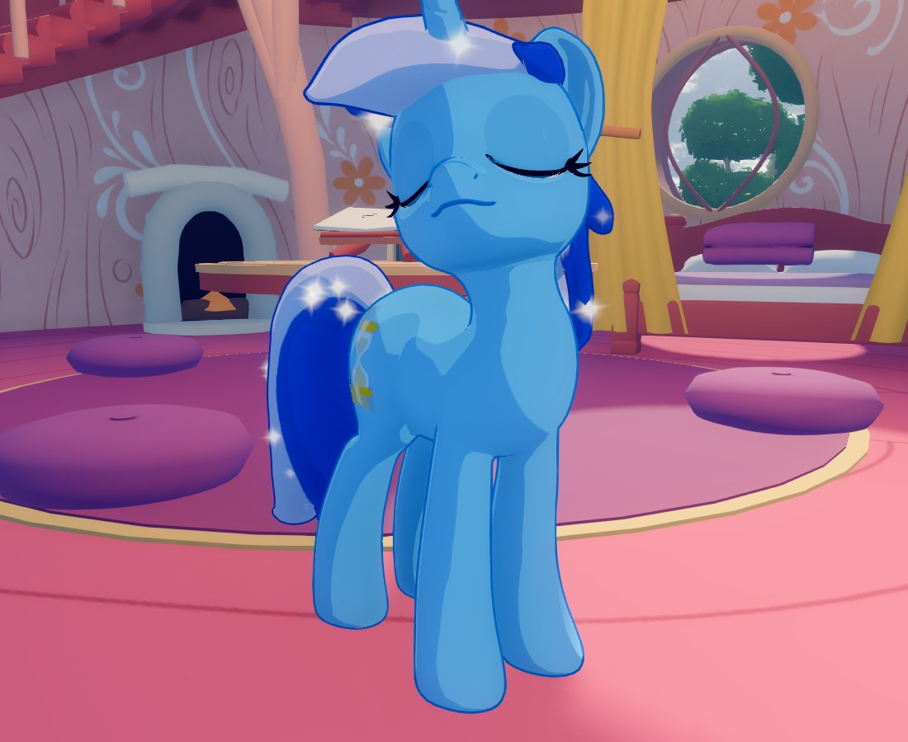
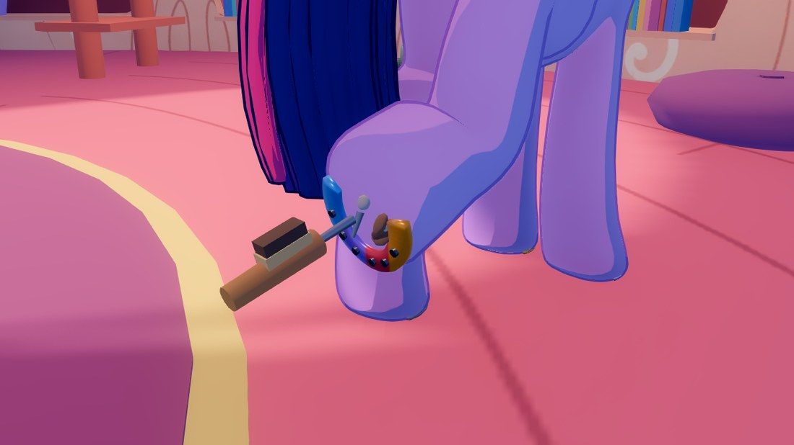
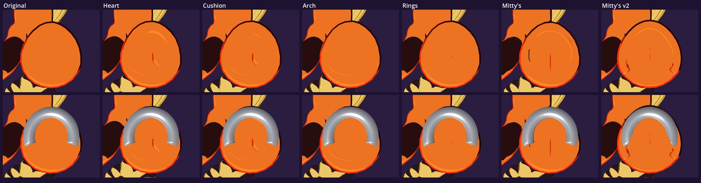
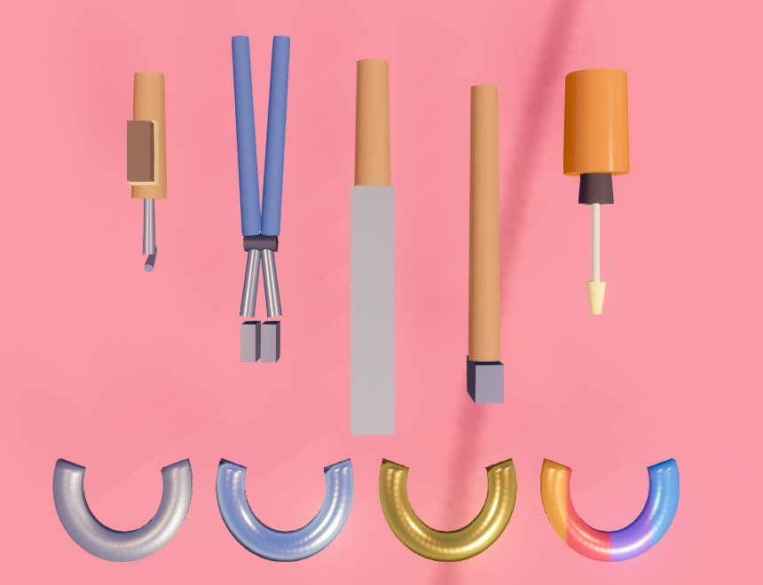
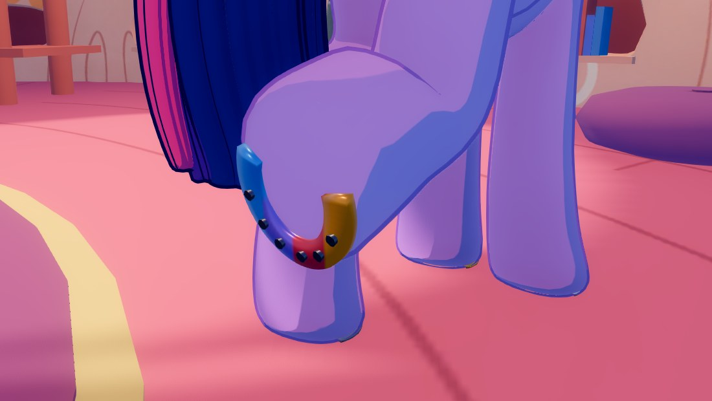

# Mare Care

A mod for [Home: Equestria](https://github.com/homedevanon/home-equestria) that adds new ways to
look after your mare.

Built for game version `0.3.0-maredev`. Works on desktop and in VR.

> **Work in progress.** Farrier work and brushing are in. Tooth brushing and bathing are next.



## Farrier

The first time you load a world with the mod on, a farrier's kit appears in your briefcase: a
**Hoof Pick**, **Hoof Nippers**, a **Hoof Rasp**, a **Farrier's Hammer**, **Hoof Oil**, and
horseshoes in four styles: **Steel**, **Silver**, **Gold** and **Rainbow**. The tools never run
out, and you can use them on any willing pony.



1. **Ask for a hoof.** Hold any farrier tool and look at one of her legs, then click (desktop),
   or touch the leg with the tool (VR). She lifts that hoof for you: a front hoof folds back at
   the knee, and a back hoof lifts out behind her with the sole facing you. She stands still while
   it's up.
2. **Work the hoof** with the tool in hand. On desktop, look at the hoof and hold the mouse
   button; the hint under the crosshair says what the tool will do and how far along it is.
   - **Hoof pick:** when picking is due, stones and packed dirt sit in the sole. Pick each one
     out and it drops to the ground.
   - **Nippers, then rasp:** trim the hoof wall with the nippers, then level it with the rasp.
     On a shod hoof, the nippers pull the shoe off first.
   - **Horseshoe:** fit one to a bare hoof. If the hoof needs a trim, trim it first.
   - **Hammer:** drive in all four nails, one click per nail. A shoe that has worked loose is
     re-nailed the same way.
   - **Hoof oil:** work it in, and the hoof shines for a few minutes.
   - **Hoof massage:** with nothing in your hand, hold the mouse button on her lifted hoof (desktop),
     or rub it slowly with your hand (VR). She relaxes into it. Grown mares only.
   - **Licking her hooves clean** (off by default: switch on **Hoof licking** in the settings):
     with nothing in your hand, get your face right up to her lifted
     hoof and hold the mouse button (desktop), or lick it slowly in VR (each fresh touch of your
     mouth is a kiss that helps too). The dirt comes away as you go, and once it's clean the hoof
     sparkles. It counts as picking, and nobody pays for it. Some mares are bemused, shy ones get
     flustered, and the bolder, bossier ones really enjoy it. Lick all four and she'll remember it.
     Grown mares only.
3. **Walk away**, or ask for another hoof, and she puts it down.

A lifted hoof shows its underside. Pick how it looks in the settings (see Settings below): the
game's own plain sole, two sets of Mitty's hooves, or one of four sculpted styles with a soft rim and a
**frog**, the cushioned pad that runs from the heels toward the toe.



**Shoe all four.** Once one hoof is shod, she'd walk lopsided until the others are too. She waits
where she is for you to finish, and the hint on a bare hoof says she'd like it shod to match. If
you walk off, or keep her waiting more than about five minutes, she gives up and leaves, a
little hurt, and remembers that you left her lopsided. She'll still pay for the full set
whenever you finish it.

Her shoes stay on, in the style you chose, wherever she goes. Every pony's hooves are saved
with your world.

| The farrier's kit | A rainbow shoe, nailed on |
| --- | --- |
|  |  |

### Paying for hoof care

Some mares pay you in bits for hoof care, out of their own purse, when they put the hoof down
again. Each job only counts if the hoof needed it. New shoes are paid for as a set, once all
four are on:

| Job | Bits |
| --- | --- |
| Picking out | 2 |
| Trim and rasp | 4 |
| Hoof oil | 2 |
| Resetting a loose shoe | 3 |
| Hoof massage | 3 |
| New shoe | steel 6, silver 9, rainbow 10, gold 12 |

About two in three grown mares pay. The rest take it as a favour between friends, and which
ones they are stays the same in every world. Hoof care is always free for your wife, and fillies
never pay. A mare who's short of bits just thanks you instead.

### Settings

**Settings > Mare Care** in the game (under Add-ons) has everything below. Changes apply right
away and are saved for next time.

- **Hoof model:** choose how a hoof looks from below, with a thumbnail of each. The hooves are
  part of the pony's body mesh, so they move, shade and cast shadows with her, and the toe keeps
  the game's own clean front edge. The choices:
  - **Original:** the game's own plain sole (the default).
  - **Heart:** a soft, pillow-shaped frog that follows the curve of the toe, with a cleft between
    its two heel lobes, set in a gently dished sole.
  - **Cushion:** like Heart, but a smaller, softer pillow in a deeper dish.
  - **Arch:** a rim in two soft steps round the toe and sides, fading out toward the heel, with a
    small heart-shaped frog near the heel.
  - **Rings:** soft concentric rings and a small cleft.
  - **Mitty's:** the hooves modelled by Mitty (see Contributors).
  - **Mitty's v2:** Mitty's second hooves, with big puffy frogs that bulge out of the sole.

  Shoes sit on any of them. Changing the model rebuilds every pony in the world, which takes a
  few seconds and can cause a brief hitch; the page says so while it happens.
- **Show the frog:** switch the frog and its cleft off if you'd rather not see them (Heart,
  Cushion, Arch and Rings).
- **Hooves get dirty:** switch this off and hooves never need picking, trimming or oiling, and
  shoes never work loose. The tools, shoes and hoof models all still work, so you can
  keep just the horseshoes and the new hooves.
- **The spa cares for hooves:** see below.
- **How long until care is due again:** one slider each for dirt building up, a trim wearing
  off, shoes working loose and the oil wearing off, from every day to every 30 days, or never
  again (once done, it stays done). These are in-game days. The default is 7.
- **Mares pay for hoof care.**
- **Sparkle:** whether a freshly brushed mane or tail sparkles, and whether an oiled or
  licked-clean hoof does, each with how long it lasts (1 to 30 minutes).
- **Hoof licking:** off by default. Switch it on to lick her hooves clean until they sparkle (see
  Farrier above).
- **Reset to defaults.**

When a job comes due the hint on her leg says so (for example "needs: picking, a trim, oil"), and
a shoe that is due sits a little crooked, with its nail heads sticking out.

### The spa

Hooves don't depend on you alone. Aloe and Lotus's spa looks after them too:

- when a client's front hooves are filed at the footbath, those hooves are cleaned out and
  trimmed;
- when her back hooves are done on the massage table, so are those, and they count as massaged;
- when a mare finishes a whole visit, all four hooves are cleaned out, trimmed and oiled, whoever
  held the file.

The upkeep clocks start again exactly as if you had done it. Switch it off in the settings if you
like.

### The settings file

The page edits `settings.cfg` in the mod's data folder, which can be edited by hand too (it
applies the next time the game starts):

| System | File |
| --- | --- |
| Windows | `%APPDATA%\home-equestria-public\mods\data\mare_care\settings.cfg` |
| Linux | `~/.local/share/home-equestria-public/mods/data/mare_care/settings.cfg` |

```ini
[upkeep]
hooves_get_dirty=true
spa_care=true
pick_days=7.0
trim_days=7.0
shoe_days=7.0
oil_days=7.0

[pay]
enabled=true

[hooves]
model="original"
show_frog=true

[extras]
hoof_licking=false

[brushing]
sparkle=true
sparkle_minutes=10.0
hoof_sparkle=true
hoof_sparkle_minutes=5.0
```

### What it does for her

Doing a job on a hoof that needed it gains a little friendship. Once all four of her hooves have
had it, she gains more and remembers it, so she can bring it up in conversation. If she isn't
paying for it, as with your wife or a mare who takes it as a favour, she also gains love if she's
an adult who is already fond of you. A paid job is just good service.

A pony who is angry with you or has asked for space won't lift a hoof. Neither will sleeping
ponies or ponies at the spa.

## Brushing

The first time you load a world with the mod on, a **Mane & Tail Brush** and a **Coat Brush**
appear in your briefcase. If the briefcase is full, they arrive the next time you load the world
with room in it.

- **Mane and tail:** hold the Mane & Tail Brush and stroke her mane or tail. While you brush her
  mane, she tilts her head into the brush. While you brush her tail, she lifts it aside and looks
  back at you. Once you're done, **her mane or tail sparkles** for about ten minutes before the
  shine slowly fades.
- **Coat:** hold the Coat Brush and stroke her neck, back, sides, chest, rump, flanks, belly or legs.
  She leans into it and finishes a long brushing with a happy stretch.

On desktop, look at the part you want to brush and hold the mouse button. In VR, just brush her.

A finished brushing takes about 10 seconds for the mane, 8 for the tail or 14 for the coat. When
it's done, she sighs contentedly, gains friendship with you, and gains love if she's an adult who
is already fond of you. She also remembers it, so she can bring it up in conversation. Each pony
gives this bonus at most once every 10 minutes per brushing. The sparkle comes every time.

A pony who is angry with you or has asked for space turns away. Sleeping ponies can't be brushed.

## Coming next

- **Tooth brushing**
- **Bathing**

## Contributors

- **aperture_tech**: Mare Care itself, including the farrier, sparkles and hoof care.
- **[modChad](https://github.com/modChad)**: the brushing groundwork, from his
  [Grooming mod](https://github.com/modChad/home-equestria-mods/tree/main/grooming).
- **Mitty**: the hoof models "Mitty's" and "Mitty's v2", hooves built into the body mesh (`hooves/`).

## Credits

- **Brushing** is built on [modChad's Grooming mod](https://github.com/modChad/home-equestria-mods/tree/main/grooming).
  This includes how brushes are detected on a pony, her poses while being brushed, the desktop
  brush strokes, the brush models and the princess hair handling. Thank you, modChad! Their mod
  also does wing preening, which this mod leaves to theirs.
- **Brushing sounds:** modChad's own recordings, from the Grooming mod.
- **Mitty's hoof models:** the hooves in `hooves/mitty_body.res` and `hooves/mitty_v2_body.res`
  come from Mitty's `hooves.glb` and `hoovespuffyfrogs1.glb` (sources kept in `hooves/source/`).
  Thank you, Mitty!
- **Sparkles, farrier tools and horseshoes:** made for this mod.
- **Farrier sounds:** the game's own foley (metal, crunch, rasp and cloth sounds).
- **Pictures:** taken in game.
- **Contented sigh:** the game's own pony breath sounds.

This is a free fan mod.

## Building from source

You need the game's source project and Godot 4.5 stable.

1. Put this folder at `res://mods/mare_care/`.
2. Open the project once so the sounds import:
   ```
   godot --headless --xr-mode off --path <project> --import
   ```
3. Build the pack:
   ```
   godot --headless --xr-mode off --path <project> --script res://tools/modding/build_mod.gd -- mare_care
   ```

To test without building, run the game with the mod unpacked:
```
godot --xr-mode off --path <project> -- --mod-src mare_care
```

### Layout

- `main.gd`: the entry script. It adds each kind of care as its own child node.
- `brushing/`: the brushes, adapted from the Grooming mod, plus `sparkle.gd` for the glints on a
  freshly brushed mane or tail.
- `ui/`: the Settings page (`settings_tab.gd`) and the list of hoof models with their
  thumbnails (`hoof_models.gd`, `thumbs/`).
- `farrier/body_hooves.gd`: the hoof models. Each sculpted model replaces the sole of every hoof in
  the shared body mesh with a new one shaped in code; Mitty's two come from `hooves/`. Switching
  clears the game's merged-mesh caches and rebuilds the ponies.
- `tools/hoof_viewer.gd`: renders every hoof model with the game's own shading, bare and shod, and
  writes the settings thumbnails. Run it with the mod at `res://mods/mare_care/`:
  `godot --xr-mode off --path <project> --script res://mods/mare_care/tools/hoof_viewer.gd`.
- `farrier/`: the farrier. `farrier.gd` runs the jobs, `hooves.gd` finds her soles and lifts
  her hooves, `shoes.gd` keeps the shoes on, `hoof_care.gd` holds what was done and when, plus
  the settings, `spa_care.gd` listens to the spa, and `models.gd` builds the tools and shoes. To regenerate the tool models:
  `godot --headless --xr-mode off --path <project> --script res://mods/mare_care/farrier/tools/make_farrier_models.gd`.
- `merge/world/food/definitions.json`: the brushes and farrier tools as non-edible briefcase items.
